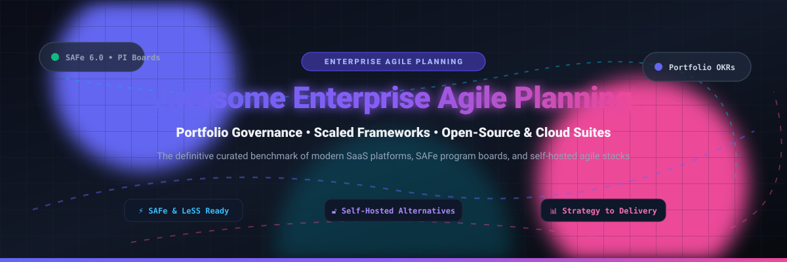

# 🚀 Awesome Enterprise Agile Planning 🎯

**Curated Benchmark of SaaS Platforms & Self-Hosted Open-Source Agile Planning Suites** 🌟

*Comprehensive guide for Portfolio Planning, Scaled Agile Framework (SAFe 6.0), Program Boards, Capacity Allocation, OKRs, and Self-Hosted Agile Platforms.*

**📅 Last updated: November 2026**

---

## 📑 Table of Contents

- [🌐 Sector Overview & Market Dynamics](#-sector-overview--market-dynamics)
- [☁️ SaaS & Hosted Enterprise Agile Platforms](#️-saas--hosted-enterprise-agile-platforms)
- [🔓 Open-Source GitHub Projects](#-open-source-github-projects)
- [🤝 How to Contribute](#-how-to-contribute)
- [💖 Support & Sponsoring](#-support--sponsoring)
- [📈 Star History](#-star-history)
- [⚠️ Disclaimer](#️-disclaimer)

---

## 🌐 Sector Overview & Market Dynamics

The global **Enterprise Agile Planning (EAP)** software market is valued between **$1.5 billion and $3.0 billion** (scaling up to **$6.8 billion** when factoring in broader strategic portfolio management, application lifecycle management, and enterprise work management tools), growing at an estimated compound annual growth rate (**CAGR**) of **14% to 27%**. 

The sector remains **highly fragmented** rather than winner-take-all:
- **Developer & DevOps Giants:** Mega-cap ecosystem players like **Microsoft (Azure DevOps)**, **GitLab**, and **Atlassian (Jira Align)** leverage established engineering footprints.
- **Dedicated Enterprise Portfolio & SAFe Suites:** Independent powerhouses such as **Planview AgilePlace**, **IBM / Apptio Targetprocess**, **Digital.ai Agility**, and **Broadcom Rally** dominate strategic portfolio management, multi-tier capacity planning, and formal SAFe ceremonies for Fortune 500 PMOs.
- **Specialized Product & Strategy Platforms:** Fast-moving innovators like **Aha! Develop**, **Dragonboat**, and **Craft.io** capture cross-functional product operations teams seeking responsive roadmapping and OKR alignments without heavy traditional PMO overhead.

---

## ☁️ SaaS & Hosted Enterprise Agile Platforms

The table below benchmarks prominent commercial enterprise agile planning tools, ordered in **descending order by company size (valuation / annual revenue)**:

| Platform | Parent Company / Ownership | Company Size (Valuation / Revenue) | Starting Pricing (Specific Tier) | Free Tier Limits / Free Trial Plan Details | Focus & Best For | Key Trade-Off |
| :--- | :--- | :--- | :--- | :--- | :--- | :--- |
| **Azure DevOps Boards** | Microsoft (NASDAQ: MSFT) | **~$3.88T Market Cap** (~$245B Annual Rev) | **$6/user/month** (Basic plan beyond free tier; billed monthly/annually) | **Free forever plan: Up to 5 Basic users** with full access (Boards, Repos, 1 parallel private pipeline with 1,800 build min/mo, 2 GiB Artifacts); unlimited Stakeholder users | Microsoft-centric engineering teams wanting integrated planning with CI/CD | Less PMO/SAFe portfolio governance depth than Rally or Jira Align |
| **Broadcom Rally** | Broadcom (NASDAQ: AVGO) | **~$1.55T Market Cap** (~$51B Annual Rev) | **$35/user/month** (Historical starting enterprise volume rate; standard tier contracts start via annual commitments) | **No self-serve free tier**; evaluated via sales-assisted guided demo or 30-day enterprise proof-of-concept (PoC) | PMO-led enterprises with existing Broadcom agreements needing Value Stream Management | High renewal/audit scrutiny; contract negotiation complexity |
| **Targetprocess** | IBM / Apptio (NYSE: IBM) | **~$240B Market Cap** (~$62B Annual Rev; Apptio acquired for $4.6B) | **$30/user/month** (Annual contract baseline, 25–50 user minimum commitment) | **No perpetual free tier**; proof-of-concept / evaluation sandboxes provided via customized sales/solution partner trial request | Mid-market to large enterprises seeking flexible, customizable visual agile boards | Deep customization increases onboarding and implementation overhead ($15K–$100K+) |
| **Jira Align** | Atlassian (NASDAQ: TEAM) | **~$50B Market Cap** (~$4.4B Annual Rev) | **$129/full user/month** (Strategy Collection baseline: $77,400/year for 1–50 full users, requires Jira Cloud Premium) | **No perpetual free tier or self-serve trial**; evaluation conducted strictly via sales-assisted interactive Demo Center walkthroughs or structured POC | Large enterprises running SAFe needing strict strategy-to-code traceability | Six-figure annual minimum commitments; mandatory Jira Premium prerequisite |
| **GitLab Enterprise** | GitLab Inc. (NASDAQ: GTLB) | **~$9.3B Market Cap** (~$700M Annual Rev) | **$29/user/month** (Premium tier; Ultimate tier at $99/user/month billed annually) | **Free forever plan: Up to 5 users** per private namespace, 400 compute min/month, 10 GiB storage; **30-day free trial** of Ultimate tier | Teams seeking product delivery and portfolio management natively embedded in DevOps CI/CD | Advanced executive roadmaps and SAFe portfolio planning require high-tier Ultimate licensing ($99/user/mo) |
| **Planview AgilePlace** | TPG Capital / TA Associates | **~$1.6B Valuation** (~$500M Annual ARR) | **$20/user/month** (Entry visual edition; enterprise tiers quote-based) | **30-day full-feature free trial** (no credit card required); no perpetual free tier | Visual Lean-Agile work management and Kanban portfolio visibility | Entry pricing reflects scoped board capabilities; enterprise portfolio scenario modeling requires top tiers |
| **Digital.ai Agility** | TPG Capital | **~$100M–$250M ARR** (Private equity backed) | **$25/user/month** (Starting rate estimate for team tiers; enterprise quotes sales-led) | **No self-serve free tier**; 14-to-30 day customized evaluation sandbox available upon request via enterprise sales demo | PMO and delivery governance with integrated enterprise DevOps toolchains | Sales-gated pricing opacity; slower self-service onboarding |
| **Aha! Develop** | Aha! Labs Inc. | **~$100M+ ARR** (Bootstrapped & profitable) | **$9/user/month** (Essentials plan billed annually; $11/user/month billed monthly) | **30-day full-featured free trial** with Advanced features (no credit card required); no perpetual free tier | Development teams already utilizing Aha! Roadmaps needing backlog and sprint execution | Per-user costs accumulate; Advanced plan ($18/user/mo) required for native Aha! Roadmaps sync |
| **Dragonboat** | Dragonboat Inc. | **~$15M Total Funding** (~$3.4M ARR) | **$39/editor/month** (Standard plan; modular add-ons from $15/editor/month; billed annually) | **14-day free trial**; free plan framework supports read-only viewers and up to 100 requestors | Product operations teams wanting OKR alignment and capacity planning without heavy enterprise PMO overhead | Less SAFe-specific program increment governance than dedicated enterprise suites |
| **Craft.io** | Craft.io Ltd. | **~$10M Total Funding** (~$6M–$7.6M ARR) | **$19/editor/month** (Starter tier billed annually; $24/editor/month billed monthly; unlimited free viewers) | **14-day free trial** on Pro tier (full features included, no credit card required); no perpetual free tier | Product management teams needing roadmap visualization with unlimited free stakeholder viewers | Editor-seat pricing model; enterprise portfolio alignment and SSO gated behind Enterprise tier |

---

## 🔓 Open-Source GitHub Projects

Self-hosted and open-source project management stacks that support agile sprint cycles, Kanban boards, Gantt timelines, and portfolio governance. Repositories are sorted in **descending order by GitHub star count**:

### 1. ✈️ [Plane](https://github.com/makeplane/plane) 
* **License:** AGPL-3.0 / Commercial Enterprise
* **Tech Stack:** Python, Django, TypeScript, Next.js, PostgreSQL, Redis, Docker
* **Overview:** The most popular modern open-source alternative to Jira and Linear. Plane provides issue tracking, epics, modules, cycle (sprint) planning, customizable boards (Kanban, List, Calendar, Gantt), team workspaces, and real-time collaboration.
* **Best For:** Agile engineering and product teams wanting a slick, modern, self-hosted project workspace.
* **Trade-Off:** Primarily optimized for team and project execution; does not offer enterprise SAFe Program Increment (PI) boards or multi-level financial scenario modeling out of the box.

---

### 2. 📋 [Focalboard](https://github.com/mattermost-community/focalboard) 
* **License:** MIT / Apache-2.0
* **Tech Stack:** Go, TypeScript, React, PostgreSQL / SQLite
* **Overview:** Developed as an open-source alternative to Trello, Notion, and Asana. Focalboard allows multi-format project tracking using Kanban boards, tables, calendars, and galleries. Integrates smoothly as a native board inside Mattermost.
* **Best For:** Teams wanting a lightweight, self-hosted card and board management system.
* **Trade-Off:** Limited native portfolio-level dependency mapping across multi-tiered teams.

---

### 3. 📌 [WeKan](https://github.com/wekan/wekan) 
* **License:** MIT
* **Tech Stack:** Node.js, Meteor, MongoDB, Docker
* **Overview:** A seasoned, fully open-source Kanban board solution. Features customizable swimlanes, card voting, rule-based automation, time tracking, multi-language support, and LDAP/OAuth enterprise authentication.
* **Best For:** Organizations seeking an on-premises Kanban tool with flexible workflow permissions.
* **Trade-Off:** Meteor architecture can be resource-intensive at large scale; lacks multi-tier portfolio epic hierarchies.

---

### 4. 🏢 [OpenProject](https://github.com/opf/openproject) 
* **License:** GPL-3.0
* **Tech Stack:** Ruby on Rails, Angular, PostgreSQL, Docker
* **Overview:** The most feature-complete open-source enterprise project and portfolio management software suite. Includes traditional Gantt charts, interactive Kanban and Scrum boards, baseline cost tracking, resource workload reporting, budgeting, and roadmap management.
* **Best For:** Enterprises and public sector bodies needing portfolio-level oversight, Gantt critical paths, and project budgeting without per-seat cloud SaaS fees.
* **Trade-Off:** Steeper learning curve; select enterprise features (like SSO and full custom boards) require an Enterprise on-premises add-on.

---

### 5. 🗂️ [Planka](https://github.com/plankanban/planka) 
* **License:** AGPL-3.0
* **Tech Stack:** Node.js, React, Redux, PostgreSQL, Docker
* **Overview:** An elegant, lightweight, and responsive real-time Kanban board designed for agile teams. Supports custom card fields, attachments, member assignments, card stopwatches for time tracking, and markdown comments.
* **Best For:** Teams that want a straightforward, clutter-free Kanban tool that deploys in seconds via Docker.
* **Trade-Off:** Built strictly for board-level execution; no native portfolio roll-ups, roadmaps, or release sprint analytics.

---

### 6. 🎯 [Leantime](https://github.com/Leantime/leantime) 
* **License:** AGPL-3.0
* **Tech Stack:** PHP, JavaScript, MySQL, Docker
* **Overview:** Strategic project management system blending goal-driven planning (OKRs, Lean Canvas) with execution (Scrum sprints, Kanban, milestone timelines, idea backlogs, and time tracking).
* **Best For:** Startups, consultancies, and cross-functional teams that need to directly connect high-level strategic objectives with daily tasks.
* **Trade-Off:** Not designed for multi-team enterprise release trains or scaled frameworks like SAFe.

---

### 7. 🐞 [Redmine](https://github.com/redmine/redmine) 
* **License:** GPL-2.0
* **Tech Stack:** Ruby on Rails, MySQL / PostgreSQL
* **Overview:** A veteran battle-tested web-based project management application. Offers multi-project tracking, role-based access control, issue tracking, Gantt charts, calendar views, wikis, and an expansive plugin ecosystem (including Scrum and agile plugins).
* **Best For:** IT departments and organizations wanting proven, extensible, self-hosted tracking with granular role control.
* **Trade-Off:** Classic UI paradigm; requires third-party plugins to match modern real-time interactive agile boards.

---

### 8. ✅ [Vikunja](https://github.com/go-vikunja/vikunja) 
* **License:** AGPL-3.0
* **Tech Stack:** Go, Vue.js, PostgreSQL / MySQL / SQLite, Docker
* **Overview:** Fast, self-hosted to-do and task management suite. Unifies your workflows across multiple synchronized perspectives: Kanban boards, Gantt timelines, tables, and task lists.
* **Best For:** Small agile teams wanting a high-performance, single-binary Go backend with clean task visualization.
* **Trade-Off:** Focuses on task management; lacks advanced capacity management and release-train ceremonies.

---

### 9. 🐳 [Taiga (Docker Engine)](https://github.com/taigaio/taiga-docker) 
* **License:** MPL-2.0 / Apache-2.0
* **Tech Stack:** Python, Django, AngularJS, PostgreSQL, Docker
* **Overview:** The complete containerized distribution of Taiga, the beloved open-source agile project tool designed for startups, designers, and Scrum enthusiasts. Features dedicated Scrum backlogs, sprint estimation poker, epics, user stories, burndown charts, and Kanban boards.
* **Best For:** Agile product teams wanting an intuitive, beautifully designed Scrum & Kanban management experience.
* **Trade-Off:** Suited for team/project sprint execution rather than enterprise portfolio governance.

---

## 🤝 How to Contribute

Contributions are warmly welcomed! Help keep this curated list complete, up-to-date, and accurate:

1. 🍴 **Fork the repository** to your GitHub account.
2. 🌿 **Create a descriptive feature branch** (`git checkout -b add-awesome-tool`).
3. 📝 **Add or update the platform entry** in `README.md` following the established table / format.
4. 🔍 **Verify details**: Include official links, accurate license types, transparent pricing tiers, and objective trade-offs.
5. 🚀 **Submit a Pull Request** with a concise description of your changes.

---

## 💖 Support & Sponsoring

If you found this curated benchmark helpful for your team, organization, or research:

- ⭐ **Star this repository** to help others discover it!
- 🍴 **Fork and share** it with your engineering and PMO colleagues.
- ☕ **Support future maintenance and open-source research** via the [GitHub Sponsor Dashboard](https://github.com/sponsors/ishandutta2007)!

Thank you to all community contributors, agile coaches, and open-source maintainers! 🚀

---

## 📈 Star History

---

## ⚠️ Disclaimer

- This is an **independent, community-curated list** — inclusion does not represent an endorsement or commercial partnership.
- **Enterprise Agile Planning vs. Team Trackers**: Dedicated portfolio suites (**Jira Align, Targetprocess, Planview AgilePlace, Digital.ai Agility, Broadcom Rally**) specialize in strategic portfolio management, multi-tier capacity heatmaps, financial scenario modeling, and SAFe PI boards. Tools like **Azure DevOps, GitLab, Dragonboat, Craft.io, and Aha! Develop** provide team-to-midmarket roadmap execution.
- **Open-source self-hosting**: When deploying open-source platforms (**Plane, OpenProject, Focalboard, WeKan, Taiga**) with sensitive company roadmap and financial data, ensure you enforce database encryption, regular backups, and strict role-based access control (RBAC).
- Pricing figures and tier conditions reflect publicly verifiable information as of late 2026 and are subject to vendor adjustments.
